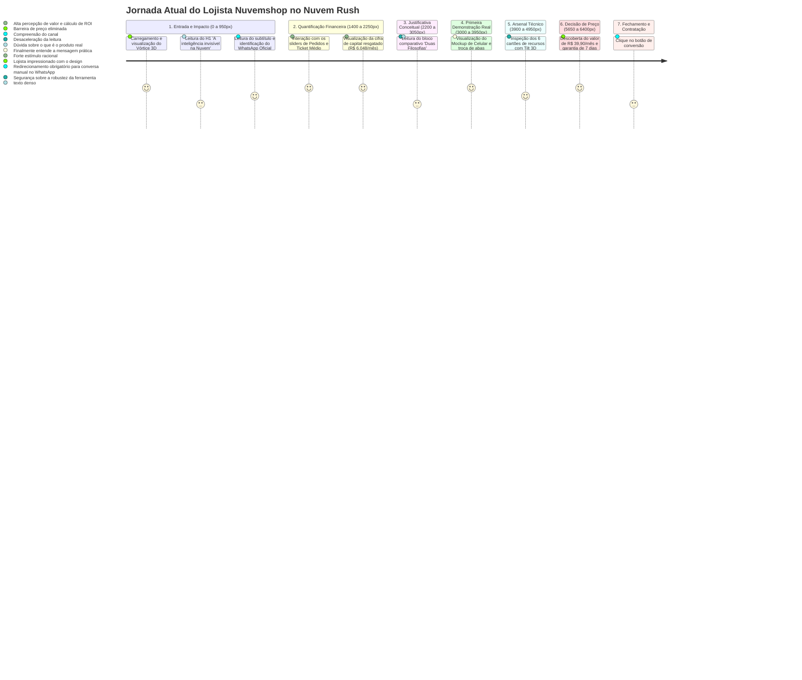

# ANÁLISE DA JORNADA COMERCIAL E FUNIL DE CONVERSÃO — NUVEM RUSH

**Projeto:** Nuvem Rush (`nuvemrush.com.br` / `rush.com.br`)  
**Data da Análise:** 16 de Novembro de 2026  
**Fase:** Fase 2A — Análise Estratégica da Experiência Comercial e Arquitetura de Conversão  
**Público-Alvo Primário:** Lojistas e tomadores de decisão da plataforma **Nuvemshop** (Pequenas, Médias e Grandes Operações de E-commerce no Brasil)  
**Status:** Diagnóstico investigativo sem alteração de arquivos de código  

---

## 1. Mapeamento da Jornada do Visitante (Funil Atual)

A jornada atual do visitante ao acessar `https://nuvemrush.com.br` percorre 7 etapas lineares ao longo de aproximadamente **7.200 pixels verticais** de rolagem em desktop e mais de **9.600 pixels** em dispositivos móveis:



---

## 2. Diagnóstico Detalhado dos Pontos de Fricção Comercial

### A. Distância Crítica até a Primeira Demonstração Prática
* **Fato Observado:** O primeiro exemplo visual concreto de como uma mensagem chega ao cliente do e-commerce localiza-se na **Seção § 03 (Playground de Fluxos)**, a mais de **3.000 pixels de distância** do topo da página.
* **Impacto Comercial:** Em testes de usabilidade e comportamento de navegação em SaaS de e-commerce, lojistas pragmáticos tomam a decisão de continuar navegando nos primeiros **5 a 8 segundos**. Exigir que o usuário role por mais de 3 telas inteiras antes de ver uma prévia visual da notificação reduz a taxa de engajamento da dobra inicial.
* **Oportunidade Estratégica:** Antecipar uma demonstração visual compacta no primeiro terço da página (ao lado do H1 no Hero ou imediatamente abaixo da barra de métricas).

---

### B. Clareza da Proposta de Valor no Primeiro Impacto
* **Texto Atual do H1:** *"A inteligência invisível que recupera suas vendas na Nuvem."*
* **Análise Heurística:** A frase possui indiscutível elegância poética e encaixa-se na direção de arte de luxo, mas peca pela ambiguidade nos primeiros 3 segundos. O lojista pode interpretar o termo "Nuvem" como computação em nuvem genérica (AWS/Google Cloud) antes de associar à plataforma Nuvemshop.
* **Subtítulo de Apoio:** O parágrafo logo abaixo corrige a ambiguidade (*"Uma camada contínua de automação para lojas Nuvemshop. Carrinhos esquecidos, confirmações de envio e recompra operando em segundo plano pelo WhatsApp Oficial da Meta"*), mas depende de esforço cognitivo adicional de leitura.
* **Recomendação:** Preservar a elegância do H1 adicionando uma ancoragem funcional direta (ex.: uma etiqueta permanente `APP HOMOLOGADO NUVEMSHOP • API OFICIAL META`).

---

### C. Estrutura e Destino das Chamadas para Ação (CTAs)
* **Comportamento Atual:** 100% dos botões principais de contratação conduzem para links externos do WhatsApp (`https://wa.me/5514996807881?text=...`) com mensagens contextualizadas.
* **Análise do Funil:**
  * **Ponto Positivo:** O contato direto pelo WhatsApp humaniza o fechamento, permitindo que a equipe de vendas tire dúvidas operacionais sobre chaves de API, cobrança da Meta e migração de loja.
  * **Ponto de Fricção:** O ecossistema Nuvemshop possui uma cultura forte de **instalação com 1 clique** via App Store oficial da Tiendanube/Nuvemshop. Lojistas técnicos ou com pressa de testar o app desistem ao perceber que precisam abrir o WhatsApp e aguardar atendimento humano em horário comercial.
* **Recomendação Estratégica:** Oferecer um **Duplo Caminho de Conversão**:
  1. *Caminho A (Autoatendimento Instantâneo):* *"Instalar na Nuvemshop"* (direcionando para `https://www.tiendanube.com/apps/34663/authorize`).
  2. *Caminho B (Ativação Guiada):* *"Falar com Especialista no WhatsApp"* (para lojistas que desejam consultoria de implantação).

---

### D. Densidade e Repetição Textual
* **Seções que desaceleram o visitante:**
  * A Seção § 02 (*"O dia a dia da sua loja sob duas filosofias distintas"*) apresenta 4 parágrafos substanciais em estilo editorial clássico que exigem leitura pausada. Para lojistas mobile, esse bloco gera sensação de lentidão no fluxo de descoberta.
* **Repetições Identificadas:**
  * A garantia de que a ferramenta utiliza a **API Oficial Meta Cloud sem risco de banimento** é repetida 5 vezes ao longo da página (Hero, Barra de Métricas, Contraste, Arsenal e FAQ). Embora seja uma objeção real de mercado, a repetição textual idêntica perde força persuasiva.

---

### E. Mapeamento de Pontos Críticos de Abandono (Drop-off)

1. **Abandono no Hero (0 a 900px):** Ocorre caso o lojista não compreenda de imediato a aplicação prática da ferramenta e não queira clicar no botão de WhatsApp sem saber mais detalhes.
2. **Abandono no Contraste Operacional (2200 a 3000px):** Bloqueio por fadiga de leitura de texto antes de atingir o mockup interativo do WhatsApp.
3. **Abandono no Rodapé Mobile (Falta de Menu):** Em smartphones, ao chegar no meio da página, o visitante que decide voltar ao início ou verificar o preço precisa rolar 4.000 pixels com o dedo devido à **ausência total do menu de navegação**.

---

## 3. Auditoria Técnica de Domínios, Links e Parâmetros Canônicos

### A. Domínio Canônico e Meta Tags de Compartilhamento
* **Tag Canônica no HTML:**
  ```html
  <link rel="canonical" href="https://nuvemrush.com.br/">
  ```
  *(Status: Correto e apontando para a raiz segura HTTPS).*
* **Open Graph (Compartilhamento em Redes e WhatsApp):**
  * `og:title`: *"Nuvem Rush — A Inteligência Invisível da sua Nuvemshop"*
  * `og:description`: *"Recuperação contínua de vendas, rastreio e pós-venda em segundo plano via WhatsApp Oficial Meta e E-mail."*
  * `og:image`: `https://nuvemrush.com.br/og-image.jpg`
  * `og:url`: `https://nuvemrush.com.br/`
  *(Status: Meta tags completas e prontas para visualização rica em links do WhatsApp e redes sociais).*

---

### B. Mapeamento dos Destinos de Todos os Botões e Links

| Botão / Link | Texto Visível | Destino Configurado no Código | Avaliação Técnica |
| :--- | :--- | :--- | :--- |
| **CTA Header Desktop** | *"Ativar Nuvem Rush"* | `href="#preco"` | Rolagem interna para seção de preço. Funcional. |
| **CTA Principal Hero** | *"Ativar no Piloto Automático"* | `href="https://wa.me/5514996807881?text=..."` | Abre WhatsApp com texto pré-preenchido. Funcional. |
| **CTA Secundário Hero**| *"Simular Retorno Financeiro ↓"*| `href="#roi"` | Rolagem suave para o simulador. Funcional. |
| **CTA do Simulador** | *"Resgatar Esse Capital Agora"*| `href="https://wa.me/5514996807881?text=..."` | Mensagem dinâmica baseada no cálculo da loja. Excelente. |
| **CTA de Preço** | *"Garantir Preço Fundador de R$ 39,90"*| `href="https://wa.me/5514996807881?text=..."` | Abre WhatsApp solicitando a condição de fundador. Funcional. |
| **CTA Final de Fechamento**| *"Ativar Minha Loja no Automático Hoje"*| `href="https://wa.me/5514996807881?text=..."` | Abre WhatsApp de fechamento. Funcional. |
| **Botão Flutuante** | *"Especialista Nuvem Rush"* | `href="https://wa.me/5514996807881?text=..."` | Suporte direto no WhatsApp. Funcional. |
| **Link App Nuvemshop** | *(Nenhum no index.html)* | Inexistente na página de marketing | **Ponto Crítico:** Falta o link oficial de autorização da Nuvemshop. |
| **Link Privacidade** | *"Política de Privacidade"* | `href="/politica-de-privacidade.html"` | Funcional em servidores; quebra em pastas locais (`/`). |
| **Link Termos** | *"Termos de Uso"* | `href="/termos-de-uso.html"` | Funcional em servidores; quebra em pastas locais (`/`). |
| **Link Cookies** | *"Política de Cookies"* | `href="/politica-de-cookies.html"` | Abre página legada em tema claro. |
| **Link Exclusão** | *"Exclusão de Dados"* | `href="/exclusao-de-dados.html"` | Abre instruções de revogação de dados Facebook. |

---

## 4. Recomendações Estratégicas para a Fase 2B (Reorganização do Funil)

1. **Incorporação de Demonstração Imediata no Hero:**
   * Apresentar uma notificação elegante simulando a mensagem oficial de WhatsApp recebida pelo comprador no próprio Hero (ou logo abaixo dos números de entrega e conversão).
2. **Implementação do Menu Hambúrguer Móvel com Acesso Direto aos CTAs:**
   * Garantir que o visitante de smartphone possa acessar o simulador, a demonstração ou a área de contratação a qualquer momento com apenas 1 toque no topo.
3. **Inclusão do CTA de Autoatendimento Oficial:**
   * Adicionar opção para instalação imediata na Nuvemshop, capturando lojistas que compram de madrugada ou sem necessidade de consultoria humana.
4. **Substituição de Emojis por Micro-Ícones Vetoriais:**
   * Elevar a percepção de valor corporativo do simulador substituindo os emojis informais por ilustrações vetoriais limpas em conformidade com o padrão Quiet Luxury.
