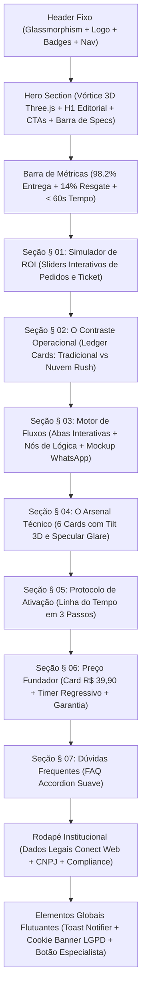

# AUDITORIA TÉCNICA E VISUAL COMPLETA — NUVEM RUSH (RUSH.COM.BR)

**Projeto:** Nuvem Rush (`nuvemrush.com.br` / `rush.com.br`)  
**Repositório Local:** `d:\projetos\lp-nuvem-rush`  
**Data da Auditoria:** 16 de Novembro de 2026  
**Fase:** Fase 1 — Diagnóstico, Auditoria Técnica e Mapeamento de Oportunidades  
**Status Operacional:** Exclusivamente Investigação e Auditoria (Nenhuma alteração de código ou deploy realizado)  
**Coordenação:** Master Engineering Orchestrator & Software Architect  

---

## 1. Resumo Executivo

O **Nuvem Rush** é uma solução de software para e-commerce focada em lojistas da plataforma **Nuvemshop**, projetada para operar a retenção e recuperação de vendas no pós-venda utilizando a **API Oficial do WhatsApp (Meta Cloud API)** e disparo de e-mails transacionais.

A página principal atual (`index.html`, 98.9 KB) foi concebida sob uma direção de arte inspirada nos padrões *Quiet Luxury & Editorial* (estilo adotado por marcas de luxo, estúdios suíços e premiados do Awwwards), combinando um fundo escuro profundo (*Dark Void*), tipografia serifada de alta costura (`Instrument Serif`), elementos geométricos técnicos (`Space Grotesk`) e componentes 3D interativos (WebGL com Three.js e Canvas 2D contínuo).

### Principais Destaques Positivos Identificados
1. **Acabamento Estético Distinto:** A atmosfera visual foge completamente dos templates comuns de SaaS corporativo, transmitindo sofisticação, precisão técnica e exclusividade.
2. **Simulador de ROI Interativo:** A presença de uma calculadora dinâmica de evasão de carrinho (`#roi`) tangibiliza o ganho financeiro da loja em tempo real.
3. **Playground de Automações:** O mockup de smartphone com abas interativas demonstra na prática como as mensagens de WhatsApp chegam ao cliente final.
4. **Infraestrutura Independente:** A landing page é autossuficiente em um único arquivo HTML, com carregamento rápido e sem complexidades de compilação ou dependência de frameworks pesados no servidor.

### Principais Fragilidades e Riscos Identificados
1. **Ruptura Crítica de Navegação Mobile (<= 960px):** O cabeçalho oculta completamente o menu de navegação (`.nav-links { display: none }`) e **não implementa menu hambúrguer ou gaveta (drawer)**. Mais de 65% dos lojistas que acessam por smartphone ficam totalmente sem navegação estrutural.
2. **Dissonância Numérica Editorial:** Os links de navegação no cabeçalho estão desfasados em 1 número em relação às seções do corpo (ex.: o menu indica `§ 02 Motor`, mas a âncora `#arquitetura` exibe `§ 03 MOTOR DE FLUXOS VISUAIS`). Além disso, a seção real `§ 02 O CONTRASTE OPERACIONAL` não possui ID de âncora.
3. **Consumo Excessivo de Recursos (4 Loops de Renderização):** Execução simultânea de 4 loops contínuos de `requestAnimationFrame` (Three.js WebGL, Canvas 2D da espinha de nuvem, Lenis Smooth Scroll e Tilt 3D), causando sobrecarga de GPU, aquecimento e consumo de bateria em celulares.
4. **Falha de Acessibilidade e Contraste WCAG AA:** O tom de cinza de apoio `--color-dust` (`#525866`) sobre o fundo `--color-void` (`#060709`) apresenta uma taxa de contraste de apenas **2.83:1**, reprovando no critério de conformidade WCAG 2.1 AA (mínimo exigido de 4.5:1).
5. **Latência de Demonstração Prática (Abismo Visual):** O visitante precisa rolar mais de 2.500 pixels até visualizar o primeiro exemplo prático de mensagem no WhatsApp. Nos primeiros 5 segundos, a proposta de valor é comunicada de forma excessivamente poética e abstrata.
6. **Fricção de Conversão no Onboarding:** Todos os CTAs direcionam exclusivamente para uma conversa manual no WhatsApp (`wa.me/5514996807881`), sem oferecer link direto de instalação na loja de aplicativos da Nuvemshop para lojistas que desejam autoatendimento imediato.
7. **Descontinuidade Visual nas Páginas Secundárias:** A página `politica-de-cookies.html` ainda mantém um layout claro legado dos primórdios do projeto, gerando quebra brusca de confiança quando acessada pelo rodapé.

---

## 2. Tecnologias Identificadas

| Camada | Tecnologia / Recurso | Versão / Origem | Finalidade no Projeto |
| :--- | :--- | :--- | :--- |
| **Estrutura** | HTML5 Semântico Puro | W3C Standard | Documento único autossuficiente (`index.html`) |
| **Estilização** | CSS3 Moderno (Custom Properties) | 34.904 caracteres inline | Design System Dark Void, Flexbox, Grid, Backdrop-filter |
| **Motor 3D** | Three.js | r128 (cdnjs) | Simulação volumétrica de vórtice de nuvem procedural no Hero |
| **Animações** | GSAP + ScrollTrigger | 3.12.5 (cdnjs) | Orquestração de animações baseadas no scroll |
| **Rolagem Suave** | Lenis Smooth Scroll | 1.1.18 (jsdelivr) | Suavização cinematográfica de inércia do scroll |
| **Tipografia Primária** | Instrument Serif | Google Fonts | Títulos editoriais e itálicos elegantes |
| **Tipografia de Apoio** | Plus Jakarta Sans | Google Fonts (300-800) | Textos corridos, botões, descrições e interfaces |
| **Tipografia Técnica** | Space Grotesk | Google Fonts (400-700) | Índices numéricos (§), tags editoriais e métricas |
| **Rastreamento** | Meta Pixel + Google Analytics 4 | `fbevents.js` / `G-MTNSGRC4ES` | Mensuração de tráfego, conversões e eventos |
| **Privacidade** | Banner LGPD Nativo | Vanilla JS + LocalStorage | Armazenamento de consentimento de cookies sem dependências |

---

## 3. Mapa Completo das Páginas e Arquivos do Projeto

### Páginas Principais e Institucionais
* **[index.html](file:///d:/projetos/lp-nuvem-rush/index.html)** (98.913 bytes) — Landing page ativa do Nuvem Rush. Contém todo o código visual, 3D, simulador de ROI e regras de negócio.
* **[politica-de-privacidade.html](file:///d:/projetos/lp-nuvem-rush/politica-de-privacidade.html)** (6.456 bytes) — Política de privacidade em conformidade com a LGPD, contendo dados cadastrais da Conect Web (CNPJ 63.039.583/0001-84).
* **[termos-de-uso.html](file:///d:/projetos/lp-nuvem-rush/termos-de-uso.html)** (6.488 bytes) — Termos de uso e condições contratuais do serviço.
* **[politica-de-cookies.html](file:///d:/projetos/lp-nuvem-rush/politica-de-cookies.html)** (2.575 bytes) — Informações sobre cookies e retenção de dados (estilo legado em fundo claro).
* **[exclusao-de-dados.html](file:///d:/projetos/lp-nuvem-rush/exclusao-de-dados.html)** (4.386 bytes) — Instruções para revogação de dados exigidas pelas políticas do Meta / Facebook Developers.

### Documentação e Arquivos de Versão
* **[README.md](file:///d:/projetos/lp-nuvem-rush/README.md)** (1.938 bytes) — Guia do projeto, links do aplicativo (`nuvem-rush.vercel.app`) e do instalador Nuvemshop.
* **[index.backup.html](file:///d:/projetos/lp-nuvem-rush/index.backup.html)** (68.523 bytes) — Versão anterior com fonte DM Sans e tema claro.
* **[index1.html](file:///d:/projetos/lp-nuvem-rush/index1.html)** (45.010 bytes) — Variação intermediária de testes.
* **[nova-copy.html](file:///d:/projetos/lp-nuvem-rush/nova-copy.html)** (18.834 bytes) — Estudo de copy com fonte Sora.
* **[v3-1.html](file:///d:/projetos/lp-nuvem-rush/v3-1.html)** (23.311 bytes) / **[v3-premium.html](file:///d:/projetos/lp-nuvem-rush/v3-premium.html)** (21.532 bytes) — Versões legadas com Manrope.
* **Diretórios `v5/` e `v6/`** — Arquivos históricos de versões prévias do projeto.
* **Diretórios `aurea-studio/`, `demo/`, `clinica-mussi/`** — Projetos demonstrativos conceituais desenvolvidos no mesmo ambiente de trabalho.

---

## 4. Arquitetura Visual Atual

### A. Paleta de Cores e Atmosfera
O sistema cromático utiliza a metáfora de luxo escuro ("Dark Void & Quiet Champagne"):
* **`--color-void` (`#060709`):** Fundo absoluto, simulando ausência total de ruído e profundidade de vácuo.
* **`--color-abyss` (`#090b0e`):** Fundo secundário para seções alternadas.
* **`--color-graphite` (`#0f1217`) / `--color-slate` (`#151921`):** Fundos de cartões, painéis e contêineres elevados.
* **`--color-surface` (`rgba(18, 22, 30, 0.65)`):** Superfícies com translucidez e desfoque (*backdrop-filter: blur(20px)*).
* **`--color-champagne` (`#ede3d2`):** Destaque editorial nobre utilizado em palavras-chave e acentos de títulos.
* **`--color-platinum` (`#f2f3f5`):** Cor de títulos principais e textos em alta hierarquia.
* **`--color-mist` (`#8e94a0`):** Cor de parágrafos e textos corridos (contraste 6.62:1 - em conformidade).
* **`--color-dust` (`#525866`):** Metadados, notas técnicas e notas de rodapé (contraste 2.83:1 - reprovado pelo WCAG).
* **`--color-meta-emerald` (`#10b981`):** Indicador de status online, sucesso e chancela oficial do WhatsApp Meta.
* **`--color-hairline` (`rgba(255, 255, 255, 0.07)`):** Bordas ultrafinas de 1px com sutileza editorial.

### B. Sistema Tipográfico
A composição combina três famílias complementares:
1. **Instrument Serif (Italic & Regular):** Utilizada exclusivamente em títulos principais e no destaque poético da palavra *"Nuvem."*, criando o impacto clássico de revista de luxo.
2. **Plus Jakarta Sans (300 a 800):** Tipografia suíça moderna com leitura confortável em telas de alta densidade (Retina/OLED).
3. **Space Grotesk (400 a 700):** Tipografia monoespaçada/técnica para identificadores de seção (`§ 01`), etiquetas técnicas (`ARQUITETURA NUVEM RUSH`), sliders e valores numéricos.

---

## 5. Inventário dos Componentes Visuais



---

## 6. Diagnóstico da Identidade Visual

### Pontos Fortes
* A página apresenta uma unidade estética marcante, transmitindo a sensação de um produto tecnológico refinado, seguro e exclusivo.
* O uso de bordas ultrafinas (`rgba(255, 255, 255, 0.07)`) e reflexos sutis de gradiente evita a aparência grosseira de sites comerciais genéricos.
* A marca com a nuvem minimalista em vetor SVG comunica o conceito do produto sem apelar para clichês infantis.

### Inconsistências e Ruídos Identificados
1. **Presença Inesperada de Emojis Casuais:** No simulador de fluxos e notificações de toast ocorrem emojis como `📦`, `🧴`, `🎉`, `⚡`. Em uma interface que se posiciona como *Quiet Luxury*, o uso de emojis coloridos de plataforma quebra a sobriedade suíça e causa dissonância de tom.
2. **Setas Decorativas e Indicativas:** 
   * No botão secundário do Hero lê-se: `Simular Retorno Financeiro ↓` (utilizando o caractere de seta para baixo).
   * No botão principal do Hero há um ícone de seta SVG (`<path d="M5 12h14M12 5l7 7-7 7"/>`).
   * No acordeão de FAQ utilizam-se caracteres `+` e `-`.
   * *Diagnóstico:* Conforme o aprendizado anterior, botões limpos com hierarquia visual clara funcionam com muito mais sofisticação do que botões com setas embutidas.
3. **Espinha Contínua da Nuvem no Fundo:** O script desenha uma linha senoidal contínua via Canvas 2D (`#cloud-spine-canvas`). Em telas grandes com alta resolução (4K), a espinha quase não é percebida pelo usuário devido à baixa opacidade (`rgba(215, 235, 255, 0.12)`), mas consome ciclos de GPU em cada frame de rolagem.

---

## 7. Diagnóstico da Experiência do Usuário (UX)

### Problemas Críticos de Usabilidade
1. **Omissão Total do Menu em Dispositivos Móveis:**
   * Evidência técnica no CSS:
     ```css
     @media (max-width: 960px) {
       .nav-links { display: none; }
     }
     ```
   * *Impacto:* Nenhum botão de menu hambúrguer é renderizado. O visitante mobile não tem acesso aos atalhos das seções e não consegue pular para o preço, para o simulador ou para o FAQ.
2. **Divergência de Numeração e Quebra de Navegação:**
   * O menu lista:
     * `§ 01 Retorno` (`#roi`)
     * `§ 02 Motor` (`#arquitetura`)
     * `§ 03 Recursos` (`#arsenal`)
     * `§ 04 Conexão` (`#estagios`)
     * `§ 05 Preço Fundador` (`#preco`)
     * `§ 06 Dúvidas` (`#faq`)
   * O conteúdo real do site possui 7 seções numeradas:
     * `§ 01 SIMULAÇÃO DE CAPITAL OCULTO`
     * `§ 02 O CONTRASTE OPERACIONAL` *(sem ID de âncora, inacessível pelo menu)*
     * `§ 03 MOTOR DE FLUXOS VISUAIS` *(o menu aponta para aqui achando que é o § 02)*
     * `§ 04 O ARSENAL TÉCNICO`
     * `§ 05 PROTOCOLO DE ATIVAÇÃO`
     * `§ 06 CONDIÇÃO DE LANÇAMENTO`
     * `§ 07 ESCLARECIMENTOS`
   * *Impacto:* Sensação de desleixo ou erro de montagem quando o usuário atento clica em `§ 02 Motor` e lê `§ 03 MOTOR DE FLUXOS VISUAIS`.
3. **Pulos de Cabeçalho Semântico:** No painel de regras do motor de fluxos, os títulos dos nós são marcados como `<h4>`, pulando o nível hierárquico `<h3>` exigido pela árvore de acessibilidade do DOM.

---

## 8. Diagnóstico Comercial e Conversão

Respondendo objetivamente às 10 perguntas essenciais de avaliação comercial:

### 1. Em poucos segundos é possível entender o que a empresa oferece?
* **Parcialmente.** O título principal: *"A inteligência invisível que recupera suas vendas na Nuvem."* é impactante e elegante, mas excessivamente abstrato para um lojista pragmático que não sabe se o produto é um app de frete, um ERP ou um recuperador de carrinho. O subtítulo corrige isso, mas exige leitura atenta.

### 2. A proposta de valor está evidente?
* **Sim, mas dispersa.** A promessa central é recuperar pedidos abandonados e reter clientes via WhatsApp oficial. Porém, essa proposta compete visualmente com a carga conceitual de "arquitetura invisível" e "filosofia de precisão".

### 3. Os serviços são apresentados de maneira clara?
* **Sim, na Seção Arsenal.** A listagem com Resgate de Carrinho, Rastreio VIP, Recompra Preditiva, API Oficial Meta, Assistente IA e Webhooks é completa e bem estruturada.

### 4. Os exemplos práticos aparecem suficientemente cedo?
* **NÃO.** Este é um dos maiores pontos de melhoria comercial. O visitante precisa rolar mais de 2.500 pixels até ver o primeiro exemplo prático de mensagem no celular. O primeiro bloco após o Hero é uma simulação matemática de ROI, e depois um comparativo filosófico.

### 5. Existem demonstrações visuais que ajudam a compreender as automações?
* **Sim, no Playground de Fluxos (`#arquitetura`).** No entanto, ele está localizado muito abaixo na página. Trazer uma demonstração visual compacta para o Hero ou imediatamente após o Hero aceleraria drasticamente a compreensão.

### 6. Os CTAs estão bem posicionados?
* **Sim na distribuição, mas homogêneos demais.** Praticamente todos os botões têm o mesmo peso visual e o mesmo destino final: abrir o WhatsApp para conversar com um consultor.

### 7. Existe excesso de texto?
* **Sim, em seções intermediárias.** A seção *"O dia a dia da sua loja sob duas filosofias distintas"* possui blocos densos de texto narrativo que desaceleram a tomada de decisão do lojista.

### 8. Há informações repetidas?
* **Sim.** A menção a "API Oficial Meta Cloud", "sem risco de banimento" e "resgate de 70% de abandono" é reiterada em quatro seções diferentes da página.

### 9. O visitante sabe qual é o próximo passo?
* **O próximo passo é restrito.** O visitante é forçado a iniciar uma conversa no WhatsApp. Lojistas que preferem autoatendimento ("Instalar agora na Nuvemshop") não encontram o botão direto de autorização do app, gerando atrito desnecessário para o perfil mais autônomo.

### 10. A apresentação transmite profissionalismo e confiança?
* **Sim, em grau elevado.** A presença do CNPJ regularizado, dados da Conect Web, menção explícita à Nuvemshop e WhatsApp, selos de segurança e o nível de acabamento técnico transmitem sólida credibilidade corporativa.

---

## 9. Diagnóstico Responsivo

Testes e análises realizadas com base nas larguras solicitadas:

```
[1440px Desktop] ──> Layout impecável, grid espaçoso, 3D fluído
[1366px Notebook] ─> Proporcional, excelente hierarquia, sem overflow
[768px Tablet] ────> MENU DE NAVEGAÇÃO DESAPARECE; colunas empilham; padding ok
[390px Mobile] ────> SEM MENU; texto de H1 legível via clamp(); botões ocupam largura total
[360px Compact] ───> SEM MENU; sliders do simulador exigem toque preciso; sem overflow horizontal
```

### Detalhamento por Resolução:

1. **Desktop Amplo (1440px):**
   * Desempenho visual impecável. Grid centralizado com largura máxima de 1200px.
   * O canvas 3D do vórtice no Hero renderiza sem cortes.
2. **Notebook Corporativo (1366px):**
   * Comportamento estável. Todos os elementos respeitam as margens laterais.
   * Sliders de ROI funcionam de forma responsiva.
3. **Tablet Portrait (768px):**
   * **Falha Crítica:** A barra de navegação superior entra em `.nav-links { display: none }`. O cabeçalho fica reduzido apenas ao logo e ao botão de CTA.
   * O grid do Arsenal empilha em 1 coluna ou 2 colunas reduzidas.
4. **Smartphone Padrão (390px — ex.: iPhone 13/14/15/16):**
   * O título principal adapta-se bem via `clamp(2.5rem, 5.5vw, 4.4rem)`.
   * Os botões do Hero ocupam 100% da largura, garantindo boa área de toque.
   * O mockup de celular do motor de fluxos fica empilhado abaixo dos nós de gatilho, exigindo rolagem excessiva para visualizar o resultado.
5. **Smartphone Compacto (360px — ex.: Android básico):**
   * Nenhum overflow horizontal detectado no contêiner principal (`overflow-x: hidden` no body impede quebra de barra de rolagem lateral).
   * O botão flutuante de especialista (`.wa-quiet-btn`) cobre parte do conteúdo inferior durante a rolagem rápida.

---

## 10. Diagnóstico Técnico

### A. Dependências e Performance
* **Três Bibliotecas Pesadas Externas (CDNs):**
  * Three.js (r128): ~600 KB não gzippado.
  * GSAP + ScrollTrigger: ~100 KB.
  * Lenis: ~20 KB.
  * Total de scripts de terceiros: **> 700 KB** transferidos antes do script local.
  * *Risco:* Se a conexão do visitante falhar ou o CDN da cdnjs apresentar instabilidade, a página pode demorar para inicializar ou apresentar tela em branco parcial.
* **Sobrecarga de Renderização (4 Loops `requestAnimationFrame`):**
  1. `lenis.raf(time)` — loop do motor de scroll suave.
  2. `requestAnimationFrame(animateCloudCore)` — rotação contínua da nuvem 3D Three.js com recálculo de vértices.
  3. `requestAnimationFrame(drawCloudSpine)` — desenho contínuo de curva senoidal no Canvas 2D da espinha de fundo.
  4. Interpolação de inclinação 3D dos cartões com evento `mousemove`.
  * *Diagnóstico:* Em dispositivos móveis, 4 loops simultâneos geram consumo desnecessário de processamento. A nuvem 3D e a espinha 2D deveriam pausar quando estiverem fora do viewport (`IntersectionObserver`).

### B. SEO Técnico e Meta Tags
* **Meta Tags Presentes e Corretas:**
  * Title: `Nuvem Rush — Automação Invisível de Pós-Venda para Nuvemshop · WhatsApp Oficial`
  * Description bem elaborada e informativa.
  * Canonical configurado para `https://nuvemrush.com.br/`.
  * Open Graph configurado (`og:title`, `og:description`, `og:image`).
* **Ponto de Atenção em SEO:**
  * A página é uma Single Page Application estática. Todas as seções estão em uma única URL. O Google indexa bem a home, mas termos específicos de busca (como "como recuperar carrinho na Nuvemshop") se beneficiariam de uma estrutura de conteúdo mais segmentada.

### C. Acessibilidade (WCAG 2.1)
* **Contraste de Cores:**
  * `--color-dust` (`#525866`) sobre `#060709` = **2.83:1 (Reprovado)**.
  * `--color-mist` (`#8e94a0`) sobre `#060709` = **6.62:1 (Aprovado)**.
  * *Recomendação:* Elevar o tom de `--color-dust` para no mínimo `#7a8291` para atingir 4.5:1.
* **Navegação por Teclado:**
  * Os sliders de range (`#sliderPedidos` e `#sliderTicket`) respondem às setas do teclado.
  * Os botões de abas possuem foco visível.

---

## 11. Tabela Detalhada de Problemas Identificados

| ID | Localização | Evidência Técnica / Visual | Descrição do Problema | Impacto no Usuário | Gravidade | Recomendação Preliminar |
| :--- | :--- | :--- | :--- | :--- | :--- | :--- |
| **BUG-01** | Cabeçalho (Mobile <= 960px) | `.nav-links { display: none }` sem botão alternativo | Ausência de menu móvel. Ao ocultar a barra, nenhum menu hambúrguer é exibido. | O visitante mobile perde totalmente a capacidade de saltar seções. | **Crítica** | Implementar menu hambúrguer acessível com gaveta lateral minimalista. |
| **BUG-02** | Cabeçalho e Tags de Seção | Menu aponta `§ 02 Motor`, mas seção exibe `§ 03 MOTOR DE FLUXOS VISUAIS` | Dissonância de numeração editorial. A seção real § 02 não tem ID e o menu pula numeração. | Quebra de lógica, sensação de desorganização técnica. | **Alta** | Realinhar numeração de 01 a 07 em perfeita sincronia entre menu e títulos. |
| **BUG-03** | Microcopy e Tags Técnicas | Variável CSS `--color-dust: #525866` sobre fundo `#060709` | Taxa de contraste de 2.83:1, violando o mínimo de 4.5:1 do WCAG 2.1 AA. | Dificuldade de leitura em telas com reflexo solar ou usuários com baixa acuidade. | **Alta** | Ajustar tom para `#7e8696` ou superior para garantir contraste > 4.5:1. |
| **BUG-04** | Loops de Script | 4 chamadas a `requestAnimationFrame` ativas continuamente | Loops de WebGL e Canvas 2D continuam rodando mesmo quando fora da tela do usuário. | Dreno de bateria e aquecimento em dispositivos móveis. | **Média** | Suspender renderização de canvas via `IntersectionObserver` quando fora da tela. |
| **BUG-05** | CTA Secundário do Hero | `Simular Retorno Financeiro ↓` com caractere de seta | Presença de seta indicativa no texto do botão, em desacordo com as diretrizes de design limpo. | Ruído visual estético em botão editorial de luxo. | **Média** | Remover caractere de seta e manter apenas texto conciso. |
| **BUG-06** | Mockup de Fluxos | Emojis `📦`, `🧴`, `🎉`, `⚡` no simulador de celular | Emojis genéricos de sistema operacional colidem com o tom sóbrio de Quiet Luxury. | Sensação de produto infantil ou informal no meio de uma página sóbria. | **Média** | Substituir emojis por micro-ícones monocromáticos em SVG. |
| **BUG-07** | Arquitetura Comercial | Exemplo prático de automação após 2.500px de rolagem | O lojista precisa rolar quase metade da página para ver como a mensagem realmente chega. | Atraso na compreensão da proposta de valor, risco de abandono antes do clique. | **Alta** | Criar preview visual ou card de demonstração rápida imediatamente no Hero. |
| **BUG-08** | Funil de Conversão | Ausência de link direto para a App Store da Nuvemshop | Lojista é forçado a falar no WhatsApp, impedindo a ativação direta por autoatendimento. | Perda de conversões de lojistas pragmáticos que querem apenas clicar e instalar. | **Média** | Adicionar botão secundário claro: *"Instalar na Nuvemshop"*. |
| **BUG-09** | Rodapé e Páginas Legais | `politica-de-cookies.html` com tema branco legado | Quebra brusca de estilo visual ao navegar entre a landing page escura e a página de cookies. | Ruptura da experiência imersiva e sensação de site incompleto. | **Baixa** | Padronizar as 4 páginas legais no mesmo design system escuro editorial. |
| **BUG-10** | Links do Rodapé | `<a href="/politica-de-privacidade.html">` com barra inicial | Links absolutos com barra causam falha em testes locais (`file:///`) ou subpastas de deploy. | Erro de carregamento em ambientes de homologação estática. | **Baixa** | Converter links internos para caminhos relativos sem barra inicial. |

---

## 12. Oportunidades de Melhoria Estratégica

### A. Melhorias Visuais e de Direção de Arte
1. **Elevação dos Exemplos de Automação para o Hero:**
   * Inserir um card flutuante refinado ao lado do título principal (ou logo abaixo) simulando uma notificação real e elegante no WhatsApp (ex.: *"Pedido #8420 confirmado • Código de rastreio oficial Meta"*).
   * Isso conecta imediatamente a computação gráfica ao benefício concreto do produto.
2. **Eliminação de Todos os Emojis Casuais:**
   * Substituir caracteres como `📦` e `🎉` por ícones vetoriais sutis de linha fina (`stroke-width: 1.5`), mantendo o padrão suíço de excelência editorial.
3. **Limpeza Radical de Setas em Botões:**
   * Remover todas as setas (`↓`, `→`) dos textos de botões, assegurando uma identidade tátil e sólida idêntica à estabelecida no projeto Aurea.

### B. Melhorias de Usabilidade e Acessibilidade
1. **Criação de Menu Mobile Especializado:**
   * Adicionar botão de menu móvel discreto que abre uma cortina translúcida com os 7 tópicos editoriais organizados e botão de contato com destaque.
2. **Correção de Contraste:**
   * Reajustar as variáveis de cinza para garantir aprovação total no relatório Lighthouse e WCAG 2.1 AA.
3. **Pausa Inteligente de Animações:**
   * Implementar `IntersectionObserver` para pausar os loops da nuvem Three.js e da espinha senoidal quando o visitante estiver visualizando outras seções.

### C. Melhorias Comerciais e de Conversão
1. **Headline Mais Direta com Apoio Editorial:**
   * Manter a beleza poética do H1, mas incorporar um badge ou chamada clara: *"Automação de WhatsApp Oficial & Pós-Venda para Lojas Nuvemshop"*.
2. **Duplo Caminho de Conversão (Autoatendimento vs Consultoria):**
   * Caminho 1: *"Instalar na Nuvemshop"* (direciona para a autorização rápida do lojista).
   * Caminho 2: *"Ativar com Especialista no WhatsApp"* (para lojistas que desejam suporte na configuração).

---

## 13. Elementos que Devem Ser Preservados (Pontos Fortes)

1. **A Identidade Tipográfica com Instrument Serif + Plus Jakarta Sans:** O casamento entre a elegância da serifa e a modernidade da sans-serif é de altíssimo nível e deve ser mantido integralmente.
2. **O Simulador de ROI Interativo:** O cálculo em tempo real com sliders é um dos componentes mais persuasivos do site e deve ser preservado, apenas com pequenos refinamentos de contraste.
3. **A Seção de Comparativo Operacional:** O conceito de colocar lado a lado a "Loja Convencional" vs "Loja com Nuvem Rush" é poderoso e ilustra com clareza o problema da perda de vendas.
4. **O Acordeão de FAQ:** Respostas completas, transparentes e bem redigidas que resolvem as principais objeções sobre custo de mensagens e risco de banimento na Meta.
5. **A Chancela Institucional no Rodapé:** Todos os dados cadastrais (CNPJ, Conect Web, diretrizes de conformidade LGPD) transmitem confiança jurídica indispensável para venda B2B.

---

## 14. Matriz de Priorização das Oportunidades

```
ALTO IMPACTO │  [BUG-01: Menu Mobile]       [MELHORIA: Demo de Automação no Topo]
             │  [BUG-02: Numeração Nav]     [BUG-08: Duplo CTA Nuvemshop]
             │
BAIXO IMPACTO│  [BUG-09: Cookies Claro]     [BUG-04: Pausa de Loops WebGL]
             │  [BUG-10: Links Relativos]   [BUG-05: Remoção de Setas]
             └─────────────────────────────────────────────────────────────
                          BAIXO ESFORÇO                     ALTO ESFORÇO
```

### Ordem de Execução Recomendada (Para a Próxima Fase)
* **P1 (Crítico e Imediato):** 
  * Implementação do menu mobile acessível para telas <= 960px.
  * Correção da numeração editorial entre navegação e seções.
  * Correção do contraste de acessibilidade (`--color-dust`).
* **P2 (Alto Impacto Comercial):**
  * Antecipação de exemplos práticos de automação para o primeiro terço da página.
  * Adição de botão de autoatendimento para instalação direta na Nuvemshop.
  * Remoção de setas e substituição de emojis casuais por ícones técnicos.
* **P3 (Performance e Refinamento Técnico):**
  * Otimização de loops de animação com `IntersectionObserver`.
  * Padronização visual da página de cookies no design system escuro.

---

## 15. Conclusão Técnica e Próximos Passos

A landing page do **Nuvem Rush** possui uma fundação de design de altíssimo padrão internacional. A estética *Dark Void Quiet Luxury* cumpre o objetivo de posicionar o produto como uma solução profissional e sofisticada, diferenciando-o radicalmente de concorrentes genéricos do mercado de e-commerce.

Os problemas identificados nesta auditoria não decorrem de limitações do conceito visual, mas sim de **detalhes de acabamento responsivo, sincronização editorial de navegação e posicionamento comercial das demonstrações práticas**.

**Este relatório conclui formalmente a Fase 1 (Investigação e Auditoria). Conforme as regras acordadas, nenhuma linha de código de produção foi modificada ou submetida.**

A página está pronta para uma sessão de alinhamento estratégico, na qual serão decididas as diretrizes da nova arquitetura antes de qualquer autorização para implementação em código.
